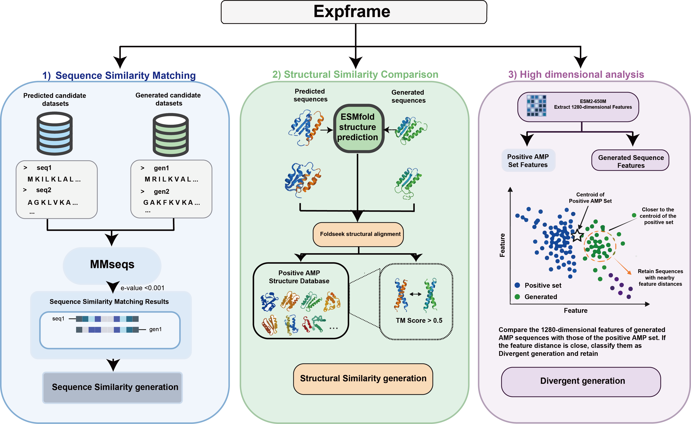

# FRAMO-AMP

**FRAMework for Overall Antimicrobial Peptide Discovery**

FRAMO-AMP 是一个面向抗菌肽（antimicrobial peptide, AMP）发现的研究软件框架，核心功能是通过 ESM2、ProtBERT 和 SaProt-ProstT5 三个分支预测 AMP；此外还提供候选序列生成，以及面向实验验证的可解释候选优先级筛选。

> 本项目用于科研候选发现。计算预测不能替代毒性、溶血性、稳定性评估及湿实验验证。

## 目录

- [功能概览](#功能概览)
- [工作流程](#工作流程)
- [系统要求](#系统要求)
- [安装](#安装)
- [快速开始](#快速开始)
- [三模型集成预测](#三模型集成预测)
- [生成候选 AMP](#生成候选-amp)
- [ExpFrame 候选优先级筛选](#expframe-候选优先级筛选)
- [输入与输出](#输入与输出)
- [模型与可复现性](#模型与可复现性)
- [项目结构](#项目结构)
- [测试](#测试)
- [常见问题](#常见问题)
- [限制与免责声明](#限制与免责声明)
- [许可证](#许可证)

## 功能概览

| 模块 | 功能 | 主要入口 |
|---|---|---|
| AMP-P | 提取 ESM2、ProtBERT、SaProt-ProstT5 特征并进行 3-MLP 集成预测 | `scripts/run_end_to_end.sh` |
| NPY inference | 对已提取且对齐的三套特征直接运行集成模型 | `amp-ensemble` |
| AMP-G | 使用仓库内置的 ProGen 模型生成候选肽 | `scripts/generate_amp.py` |
| LoRA | 使用自有 AMP FASTA 微调生成模型 | `scripts/finetune_generation_lora.py` |
| ExpFrame | 用序列、结构和 embedding 证据筛选实验候选 | `scripts/expframe_filter.py` |

项目包含以下可直接使用的训练产物：

- 三个训练完成的 MLP checkpoint；
- 与每个 MLP 匹配的训练集 scaler、模型配置及决策阈值；
- ProGen 生成模型：两个 Git LFS `safetensors` 分片，共约 3.06 GB；
- 所有已提交模型文件的 SHA-256 校验信息。

ESM2、ProtBERT、SaProt 和 ProstT5 等上游特征模型不会提交到普通 Git 历史中。下载脚本会获取固定版本并校验文件。

## 工作流程

```text
Input FASTA ─┬─ ESM2 mean embedding ───────── ESM2-MLP ───────┐
             ├─ ProtBERT mean embedding ───── ProtBERT-MLP ───┼─ 2/3 vote
             └─ ProstT5 3Di + SaProt mean ── SaProt-MLP ─────┘
                                                                │
                                                                ▼
                                                        predictions.tsv
                                                                │
ProGen generation ── generated FASTA ── AMP-P prediction ───────┤
                                                                ▼
                         MMseqs2 sequence + Foldseek structure + ESM2 CLS ExpFrame
                                                                │
                                                                ▼
                                                        retained_amp.fasta
```

AMP-P 中的三个分支分别使用自己的训练集标准化参数和交叉验证阈值。最终结果默认采用 2/3 多数投票。

## 系统要求

### 基础环境

- Linux（推荐）；
- Python 3.10 或更高版本；
- Git LFS；
- PyTorch 2.1 或更高版本。

### GPU 与外部工具

| 工作内容 | 要求 |
|---|---|
| 已有 NPY 的 MLP 推理 | CPU 或 CUDA GPU |
| 三种特征的端到端提取 | NVIDIA GPU、CUDA 版 PyTorch |
| SaProt-ProstT5 分支 | Foldseek 10 或更高版本 |
| ProGen 生成 | 推荐 NVIDIA GPU；CPU 可运行但较慢 |
| ExpFrame 序列分支 | MMseqs2 |
| ExpFrame 结构分支 | ESMFold 预测结构及 Foldseek |

完整使用生成模型和三种特征模型时，请预留约 12 GB 以上磁盘空间用于模型权重；运行输出和缓存需要额外空间。

## 安装

```bash
git lfs install
git clone https://github.com/huhubio/FRAMO-AMP-FRAMework-for-overall-AMP-discovery-.git
cd FRAMO-AMP-FRAMework-for-overall-AMP-discovery-

python -m venv .venv
source .venv/bin/activate
python -m pip install --upgrade pip
pip install -e '.[extract,generation]'
```

确认生成模型权重不是 LFS 指针文件：

```bash
git lfs pull
ls -lh AMP_generation/model-*.safetensors
```

两个分片应分别约为 1.78 GB 和 1.28 GB。可进一步执行完整性校验：

```bash
(cd AMP_generation && sha256sum -c SHA256SUMS)
(cd models && sha256sum -c SHA256SUMS)
```

如需端到端特征提取，请确认 Foldseek 可用：

```bash
foldseek version
```

## 快速开始

### 1. 准备 FASTA

```fasta
>peptide_1
KWKLFKKIEKVGQNIRDGIIKAGPAVAVVGQATQIAK
>peptide_2
GIGKFLHSAKKFGKAFVGEIMNS
```

每条记录应使用唯一的序列 ID。保存为 `input.fasta`。

### 2. 从 FASTA 完成三模型预测

```bash
scripts/run_end_to_end.sh input.fasta results/example
```

首次运行会下载并校验固定版本的 ESM2、ProtBERT、SaProt 和 Foldseek ProstT5 权重，共约 8.7 GiB。最终预测表位于：

```text
results/example/predictions.tsv
```

其中 `ensemble_prediction=1` 和 `ensemble_label=AMP` 表示多数投票预测为 AMP。

### 3. 生成新序列后进行预测

```bash
CUDA_VISIBLE_DEVICES=0 python scripts/generate_amp.py \
  --num-return-sequences 100 \
  --min-seq-length 8 \
  --max-seq-length 25 \
  --batch-size 16 \
  --out results/generated_amp.fasta

scripts/run_end_to_end.sh \
  results/generated_amp.fasta \
  results/generated_amp_screening
```

生成序列保存在 `results/generated_amp.fasta`，集成预测保存在 `results/generated_amp_screening/predictions.tsv`。

## 三模型集成预测

### 推荐：从 FASTA 端到端运行

```bash
scripts/run_end_to_end.sh INPUT.fasta OUTPUT_DIR
```

可通过环境变量控制 GPU 和批大小：

```bash
FRAMO_GPUS=0 \
ESM2_BATCH_SIZE=32 \
PROTBERT_BATCH_SIZE=16 \
SAPROT_BATCH_SIZE=8 \
PROSTT5_GPU=1 \
scripts/run_end_to_end.sh input.fasta results/run_01
```

默认使用以下固定流程：

1. ESM2-650M residue mean pooling；
2. ProtBERT residue mean pooling；
3. ProstT5 生成 Foldseek 3Di token，SaProt-650M 对配对 token 进行 mean pooling；
4. 各特征使用对应训练集 scaler 标准化；
5. 三个 MLP 分别应用自己的交叉验证阈值；
6. 至少两个模型为阳性时输出 AMP。

### 使用已有 NPY

编辑 `examples/manifest.json`，使每个成员指向相应的 `.npy`、`.metadata.tsv`、checkpoint、配置和 scaler：

```bash
amp-ensemble \
  --manifest examples/manifest.json \
  --strategy majority \
  --output predictions.tsv
```

三份 metadata 的 `seq_id` 和顺序必须完全一致。需要软投票时可使用：

```bash
amp-ensemble \
  --manifest examples/manifest.json \
  --strategy soft \
  --soft-threshold 0.5 \
  --output predictions.tsv
```

### 分步提取特征

先下载固定版本的上游模型：

```bash
python scripts/download_backbones.py
```

ESM2：

```bash
python scripts/extract_esm2_embeddings.py input.fasta \
  --model-dir models/backbones/esm2_t33_650M_UR50D \
  --model-name esm2_t33_650M_UR50D \
  --output-dir output/features/esm2 \
  --gpus 0 --batch-size 32 --pooling mean \
  --model-dtype float16 --output-dtype float32
```

ProtBERT：

```bash
python scripts/extract_protein_lm_embeddings.py input.fasta \
  --model-dir models/backbones/prot_bert \
  --model-name prot_bert --model-type protbert \
  --output-dir output/features/protbert \
  --gpus 0 --batch-size 16 --pooling mean \
  --model-dtype float16 --output-dtype float32
```

ProstT5 3Di 与 SaProt：

```bash
python scripts/build_saprot_structure_tokens_with_prostt5.py \
  --fasta input.fasta \
  --prostt5_model models/backbones/ProstT5_foldseek \
  --out_tsv output/structure_tokens/input.prostt5_3di.tsv \
  --audit_tsv output/structure_tokens/input.prostt5_3di.audit.tsv \
  --tmp_dir output/foldseek_tmp \
  --foldseek_bin foldseek --threads 16 --gpu

python scripts/extract_protein_lm_embeddings.py input.fasta \
  --model-dir models/backbones/SaProt_650M_AF2 \
  --model-name SaProt_650M_AF2 --model-type saprot \
  --structure-tsv output/structure_tokens/input.prostt5_3di.tsv \
  --output-dir output/features/saprot_prostt5 \
  --gpus 0 --batch-size 8 --pooling mean \
  --model-dtype float16 --output-dtype float32
```

每个提取器都会生成 `.npy` 和对应的 `.metadata.tsv`。metadata 记录特征行号、序列 ID、清洗后序列、截断数量和来源 FASTA。

## 生成候选 AMP

生成入口为 `scripts/generate_amp.py`，核心实现位于 `src/framo_amp/generation/progen.py`，本地模型位于 `AMP_generation/`。默认参数来自 `configs/default.yaml`，命令行参数优先级更高。

### 单 GPU

```bash
CUDA_VISIBLE_DEVICES=0 python scripts/generate_amp.py \
  --model-dir AMP_generation \
  --num-return-sequences 1000 \
  --min-seq-length 8 \
  --max-seq-length 25 \
  --batch-size 16 \
  --seed 42 \
  --out results/generated_amp.fasta
```

如果显存不足，请依次将 `--batch-size` 调整为 `8`、`4` 或 `1`。

### 多 GPU

```bash
CUDA_VISIBLE_DEVICES=0,1 torchrun --nproc_per_node=2 scripts/generate_amp.py \
  --num-return-sequences 5000 \
  --batch-size 16 \
  --out results/generated_amp.fasta
```

`--num-return-sequences` 是所有 GPU 合计的目标数量。各 rank 生成互不重叠的子集，只有 rank 0 汇总并写出结果。

### CPU

```bash
python scripts/generate_amp.py \
  --device cpu \
  --num-return-sequences 10 \
  --batch-size 1 \
  --out results/generated_amp_cpu.fasta
```

### 主要生成参数

| 参数 | 默认值 | 说明 |
|---|---:|---|
| `--num-return-sequences` | 1000 | 目标有效序列数 |
| `--min-seq-length` / `--max-seq-length` | 8 / 25 | 接受的序列长度范围 |
| `--batch-size` | 32 | 每个进程的生成批大小 |
| `--seed` | 42 | 随机种子 |
| `--temperature-min` / `--temperature-max` | 0.8 / 1.0 | 采样温度范围 |
| `--top-k` | 30 | top-k sampling |
| `--top-p` | 0.9 | nucleus sampling 阈值 |
| `--repetition-penalty` | 1.1 | 重复惩罚 |
| `--max-attempts-factor` | 5 | 长度过滤失败时的最大尝试倍数 |

程序同时写出 FASTA 和同名 JSON。JSON 保存全部采样参数及生成序列，用于复现和审计。

### LoRA 微调

```bash
torchrun --nproc_per_node=4 scripts/finetune_generation_lora.py \
  --fasta data/my_amp_dataset.fasta \
  --dataset-name my_amp_dataset \
  --save-dir lora_runs/my_amp_dataset \
  --num-train-epochs 5 \
  --per-device-train-batch-size 8 \
  --bf16
```

最终 adapter 保存在 `lora_runs/my_amp_dataset/final/`。使用该 adapter 生成：

```bash
python scripts/generate_amp.py \
  --adapter-dir lora_runs/my_amp_dataset/final \
  --num-return-sequences 1000 \
  --out results/generated_amp_lora.fasta
```

更多生成模型信息见 [AMP_generation/README.md](AMP_generation/README.md)。

## ExpFrame 候选优先级筛选

ExpFrame 在 AMP-P 之后整合三类可解释证据，为实验验证选择候选：

| 类别 | 判定规则 |
|---|---|
| `sequence_similarity` | MMseqs2 E-value `< 1e-3` |
| `structure_similarity` | 未进入序列类，且 Foldseek TM-score `> 0.5` |
| `divergent_generation` | 前两类未命中，但 ESM2 CLS 特征接近阳性 AMP embedding 流形 |
| `not_retained` | 未满足上述证据 |



原始方法描述见 [Expframe.md](Expframe.md)。

### 准备结构

本仓库不自动下载或运行 ESMFold。请先用 ESMFold 分别预测候选肽和阳性 AMP 参考集的结构，并将 PDB/mmCIF 文件放入两个目录。结构文件 ID 需要与候选 `seq_id` 和参考 FASTA ID 对应。

### 完整运行

```bash
python scripts/expframe_filter.py \
  --predictions-tsv results/generated_amp_screening/predictions.tsv \
  --positive-reference-fasta data/positive_amp.fasta \
  --sequence-reference-fasta data/high_confidence_predicted_amp.fasta \
  --run-mmseqs \
  --mmseqs-bin mmseqs \
  --run-foldseek \
  --foldseek-bin foldseek \
  --candidate-structure-dir results/esmfold/candidates \
  --reference-structure-dir results/esmfold/positive_reference \
  --esm2-model-dir models/backbones/esm2_t33_650M_UR50D \
  --gpus 0 \
  --output-dir results/expframe
```

如果省略 `--sequence-reference-fasta`，MMseqs2 会使用 `--positive-reference-fasta`。`--esm2-model-dir` 会自动提取 ExpFrame 所需的 leading `[CLS]` 特征；AMP-P 分类使用的 mean pooling 特征不能替代该特征。

embedding 阈值只从阳性参考集估计。默认采用阳性集 reference-to-centroid 距离和 leave-one-out 最近邻距离的第 95 百分位数；候选必须同时满足两个距离阈值。可使用 `--embedding-quantile` 调整分位数。

### 复用已有结果

```bash
python scripts/expframe_filter.py \
  --predictions-tsv results/generated_amp_screening/predictions.tsv \
  --positive-reference-fasta data/positive_amp.fasta \
  --mmseqs-results results/mmseqs_hits.tsv \
  --foldseek-results results/foldseek_hits.tsv \
  --candidate-embeddings results/esm2_cls/candidates.npy \
  --candidate-metadata results/esm2_cls/candidates.metadata.tsv \
  --reference-embeddings results/esm2_cls/positive_reference.npy \
  --reference-metadata results/esm2_cls/positive_reference.metadata.tsv \
  --output-dir results/expframe
```

仅调试部分模块时可添加 `--allow-partial`。正式筛选建议提供完整的序列、结构和 embedding 证据。

最终实验候选位于：

```text
results/expframe/retained_amp.fasta
```

每条候选的命中对象、距离、阈值、类别和保留状态记录在 `results/expframe/expframe_results.tsv`。

## 输入与输出

### FASTA 输入

- 推荐使用唯一且不包含空格的首字段作为 `seq_id`；
- AMP-P 特征提取器会将部分非标准残基转换为 `X`；
- ExpFrame 仅保留由 20 种标准氨基酸组成的序列；
- ExpFrame 会按完整氨基酸序列去重，并将处理原因写入 `input_audit.tsv`。

### 端到端预测输出

```text
OUTPUT_DIR/
├── features/
│   ├── esm2/*.npy
│   ├── protbert/*.npy
│   └── saprot_prostt5/*.npy
├── structure_tokens/*.prostt5_3di.tsv
├── manifest.json
└── predictions.tsv
```

`predictions.tsv` 包含每个 MLP 的分数、阈值和二分类结果，以及 `ensemble_score`、`ensemble_prediction` 和 `ensemble_label`。

### ExpFrame 输出

```text
results/expframe/
├── expframe_results.tsv
├── retained_amp.fasta
├── sequence_similarity.fasta
├── structure_similarity.fasta
├── divergent_generation.fasta
├── input_audit.tsv
├── summary.tsv
└── work/
```

## 模型与可复现性

### 三个 MLP

| 成员 | 架构 | Dropout | 参数量 | 决策阈值 |
|---|---|---:|---:|---:|
| ESM2-MLP | 1280 → 512 → 1 | 0.20 | 656,385 | 0.500 |
| SaProt-ProstT5-MLP | 1280 → 512 → 256 → 128 → 1 | 0.35 | 820,225 | 0.795 |
| ProtBERT-MLP | 1024 → 512 → 256 → 128 → 1 | 0.50 | 689,153 | 0.850 |

详细架构、固定上游模型 revision 和文件校验值见：

- [docs/MODELS.md](docs/MODELS.md)
- [models/model_manifest.json](models/model_manifest.json)
- [configs/backbones.json](configs/backbones.json)
- [AMP_generation/model_manifest.json](AMP_generation/model_manifest.json)

为了保持与训练分布一致：

- 三模型分类特征必须使用 `mean` pooling；
- SaProt 输入必须使用与氨基酸逐位对齐的 ProstT5/Foldseek 3Di token；
- 不应交换不同模型之间的 scaler；
- ExpFrame embedding 分支必须使用 ESM2 leading `[CLS]` pooling；
- 建议保存生成 JSON、特征 metadata、manifest 和完整命令行参数。

## 项目结构

```text
FRAMO-AMP/
├── AMP_generation/       # ProGen 配置、Tokenizer、代码和 LFS 权重
├── configs/              # 生成默认值及固定 backbone 清单
├── docs/                 # 模型和参数文档
├── examples/             # NPY 推理 manifest 示例
├── models/               # 三个 MLP、scaler、配置及校验清单
├── scripts/              # 生成、特征提取、预测流水线和 ExpFrame 入口
├── src/amp_ensemble/     # 三模型推理包
├── src/framo_amp/        # 生成与 ExpFrame 核心实现
├── tests/                # 单元测试
├── Expframe.md
└── Expframe.png
```

## 测试

```bash
pip install -e '.[test]'
python -m unittest discover -s tests -v
```

从未安装项目的源码目录直接测试时：

```bash
PYTHONPATH=src python -m unittest discover -s tests -v
```

## 常见问题

### 权重文件只有几百字节

这是 Git LFS 指针尚未展开。执行：

```bash
git lfs install
git lfs pull
```

### CUDA out of memory

减小相应的 batch size。生成使用 `--batch-size`；端到端预测使用 `ESM2_BATCH_SIZE`、`PROTBERT_BATCH_SIZE` 和 `SAPROT_BATCH_SIZE`。

### 找不到 Foldseek 或 MMseqs2

确认命令在 `PATH` 中，或分别通过 `--foldseek-bin`、`--mmseqs-bin` 提供可执行文件路径。

### 三套 NPY 无法集成

检查每个 `.metadata.tsv` 的 `seq_id` 是否完全相同且顺序一致，并确认 pooling、特征维度和 scaler 与对应模型匹配。

### ExpFrame 没有产生 divergent candidates

确认提供的是 ESM2 CLS 特征，而不是分类阶段的 mean-pooled ESM2 特征。检查 `expframe_results.tsv` 中的 centroid 和 nearest-neighbour 距离及阈值。

## 限制与免责声明

- 本框架输出的是计算候选，不代表已验证的抗菌活性；
- 模型可能受到训练数据组成、序列同源性和物种分布偏差影响；
- ExpFrame 是优先级排序方法，不是安全性评价模块；
- 合成前应进一步评估细胞毒性、溶血性、溶解性、稳定性和可制造性；
- 任何生物医学结论均应由适当的实验和专业人员确认。

## 引用

如果该软件用于研究，请引用本 GitHub 仓库及所使用的具体 commit，并同时引用 ESM2、ProtBERT、SaProt、ProstT5、ProGen、ESMFold、MMseqs2 和 Foldseek 的原始工作。正式论文或 DOI 信息发布后可在此处补充。

## 许可证

本仓库代码采用 [MIT License](LICENSE)。上游模型、数据集和外部工具仍受各自许可证约束；使用或再分发前请分别确认其条款。
